# Hostel_Management-

A desktop-based Hostel Management System developed using **Java Swing/AWT, JDBC, and MySQL**.
See [requirements.md](requirements.md) for the application requirements and role permissions.

The application provides a centralized system for managing hostel students, rooms, room allocations, fees, visitors, complaints, and administrative activity logs. It uses a layered structure with separate **UI, DAO, model, and database** components.
The desktop UI uses a dark navy horizontal navigation bar, an indigo accent palette, slate workspace surfaces, and consistent card and table styling.

## Features

* Admin and warden authentication
* Dashboard with hostel statistics
* Student management
* Room management
* Room allocation and vacating
* Automatic room occupancy tracking
* Hostel fee management
* Visitor entry and exit management
* Student complaint management
* Administrative activity logs
* Student and room search
* Form validation
* MySQL database persistence
* JDBC-based database connectivity
* Sample database records for demonstration
* Self-test utility for basic system verification
* Role-specific administrator, warden, and student portals
* Students can view only their own records and submit complaints

## Technology Stack

| Technology      | Purpose                          |
| --------------- | -------------------------------- |
| Java            | Core application development     |
| Swing           | Desktop graphical user interface |
| AWT             | UI components and layouts        |
| JDBC            | Java–MySQL connectivity          |
| MySQL           | Relational database              |
| MySQL Workbench | Database creation and management |

## Application Architecture

The application follows a simple layered architecture:

```text
┌──────────────────────────────────────┐
│          Java Swing / AWT UI         │
│                                      │
│ Login • Dashboard • Student • Room   │
│ Allocation • Fees • Visitors         │
│ Complaints • Activity Logs           │
└──────────────────┬───────────────────┘
                   │
                   ▼
┌──────────────────────────────────────┐
│               DAO Layer              │
│                                      │
│ StudentDAO • RoomDAO • FeeDAO        │
│ AllocationDAO • VisitorDAO           │
│ ComplaintDAO • UserDAO               │
│ ActivityLogDAO • DashboardDAO        │
└──────────────────┬───────────────────┘
                   │
                   │ JDBC
                   ▼
┌──────────────────────────────────────┐
│          MySQL Database              │
│         hostel_management            │
└──────────────────────────────────────┘
```

## Application Modules

### 1. Authentication

The application starts with a login screen.

Users are authenticated against the MySQL `users` table before accessing the management dashboard.

The three account types have separate purposes and permissions:

| Account type | Sign-in screen | What the account can do | What it cannot do |
| --- | --- | --- | --- |
| **Administrator** | Staff sign-in | Manage students, rooms, allocations, fees, visitors, and complaints; view activity/audit logs | — |
| **Warden/Staff** | Staff sign-in | Manage students, rooms, allocations, fees, visitors, and complaints | Cannot view activity/audit logs |
| **Student** | Student Portal | View only their own profile, room allocation, fees, complaints, and visitor records; submit a complaint; change their own password | Cannot open staff screens, view other students' records, edit hostel/fee/visitor records, or view audit logs |

These are enforced by separate staff and student login flows, role checks on the staff dashboard, and student-data queries restricted to the authenticated student's ID. Students use the **Student? Sign in to your portal** link on the staff sign-in screen. A student account is separate from the staff `users` table. Keep enrollment phone numbers accurate and only provide them to the intended student.

### 2. Dashboard

The dashboard provides an overview of the hostel, including statistics such as:

* Total students
* Total rooms
* Occupied rooms
* Available rooms
* Pending fees
* Pending complaints

The statistics are retrieved from the database rather than being hardcoded.

### 3. Student Management

The Student Management module provides CRUD operations for student records.

Available operations:

* Add student
* Update student
* Delete student
* Search students
* View all students
* Clear form

Student information includes:

* Roll number
* Name
* Gender
* Phone
* Email
* Course
* Year
* Address

### 4. Room Management

The Room Management module manages hostel room information.

Available operations:

* Add room
* Update room
* Delete room
* Search rooms
* View room records

Room information includes:

* Room number
* Block
* Floor
* Room type
* Capacity
* Occupancy
* Status

Room occupancy and availability are maintained as students are allocated or vacated.

### 5. Room Allocation

The Allocation module connects students with hostel rooms.

The system supports:

* Room allocation
* Viewing active allocations
* Vacating rooms
* Occupancy updates
* Room availability checks
* Prevention of duplicate active allocations

When a student is allocated or vacated, the corresponding room occupancy is updated in the database.

### 6. Fee Management

The Fee Management module maintains hostel payment records.

Information includes:

* Student
* Amount
* Payment date
* Payment status
* Payment mode
* Remarks

Fee amounts are displayed and logged in Indian rupees (INR), using the ₹ symbol and Indian digit grouping.

Supported payment modes include:

* Cash
* UPI
* Card
* Bank Transfer

### 7. Visitor Management

The Visitor Management module records visitors entering the hostel.

Information includes:

* Student
* Visitor name
* Relation
* Phone
* Visit date
* In time
* Out time

The module also supports recording the visitor's exit time.

### 8. Complaint Management

Students' hostel-related complaints can be recorded and tracked.

Complaint information includes:

* Student
* Complaint type
* Description
* Complaint date
* Status

Complaint statuses include:

* Pending
* In Progress
* Resolved

### 9. Activity Logs

Administrative actions are recorded in the `activity_logs` table.

This provides a basic audit trail of important activities performed within the application.

## Database

The application uses a MySQL database named:

```text
hostel_management
```

The database contains the following tables:

| Table           | Purpose                         |
| --------------- | ------------------------------- |
| `users`         | Authentication and user roles   |
| `students`      | Student records                 |
| `student_accounts` | Student portal credentials (PBKDF2 hashes) |
| `rooms`         | Hostel room records             |
| `allocations`   | Student-room allocations        |
| `fees`          | Hostel fee/payment records      |
| `visitors`      | Visitor records                 |
| `complaints`    | Student complaints              |
| `activity_logs` | Administrative activity history |

The schema and optional sample records are provided separately:

```text
database-setup.sql       # non-destructive schema setup
database-demo-data.sql   # repeatable sample data
database.sql             # legacy destructive reset-and-demo script
```

## Requirements

Before running the application, install:

* Java JDK 21 or later
* MySQL Server
* MySQL client (Workbench is optional)
* Git (optional, for cloning the project)

The project includes MySQL Connector/J:

```text
lib/mysql-connector-j-8.3.0.jar
```

## Database Setup

### 1. Start MySQL

Make sure your MySQL server is running.

### 2. Create the schema

For a new database or to add any missing tables without deleting existing data, open and execute:

```text
database-setup.sql
```

This creates the nine application tables if needed and adds the demo staff login accounts only if those usernames do not already exist. It does not insert sample student/fee/visitor records.

`database.sql` is a legacy demo-data/reset script. It **drops and recreates the application tables**, so only run it when you intend to erase and replace their contents.

### 3. Add demo data

Execute:

```text
database-demo-data.sql
```

This repeatable seed script adds the sample students, rooms, allocations, fees, visitors, complaints, and activity logs only when missing. It updates room occupancy to match active allocations and does not drop tables or replace existing user records.

`database.sql` is a legacy full reset-and-demo script that drops and recreates tables. Use it only when you intentionally want to erase and replace the database contents.

### 4. Verify the database

In MySQL Workbench or a MySQL command-line client:

```sql
USE hostel_management;
SHOW TABLES;
```

You should see these nine tables:

```text
users
students
student_accounts
rooms
allocations
fees
visitors
complaints
activity_logs
```

## Configuration

The project does not store database credentials in the repository.

Copy:

```text
db.properties.example
```

to:

```text
db.properties
```

Then edit the local file:

```properties
db.url=jdbc:mysql://localhost:3306/hostel_management?useSSL=false&allowPublicKeyRetrieval=true&serverTimezone=UTC
db.user=root
db.password=YOUR_MYSQL_PASSWORD
```

Set `db.user` and `db.password` to your local MySQL credentials. Keep them only in the untracked `db.properties` file; do not put credentials in source files. The application uses the database account configured here, not the demo `admin` login.


### Important

`db.properties` is intentionally excluded from Git using `.gitignore`.

Never commit real database passwords, API keys, tokens, or other credentials to a public repository.

## Running the Application

### Option 1 — Using the helper script

On macOS/Linux:

```bash
chmod +x run.sh
./run.sh
```

On Windows:

```bat
run.bat
```

### Option 2 — Using an IDE

Import/open the project in a Java IDE such as Eclipse.

Make sure:

1. The JDK is configured.
2. The MySQL Connector/J JAR is added to the project classpath.
3. MySQL Server is running.
4. The `hostel_management` database has been created.
5. `db.properties` contains the correct local credentials.

Run:

```text
src/Main.java
```

### Option 3 — Command Line

Compile the source files with the MySQL Connector/J JAR on the classpath.

Example on macOS/Linux:

```bash
javac -cp "lib/mysql-connector-j-8.3.0.jar" -d bin $(find src -name "*.java")
```

Run:

```bash
java -cp "bin:lib/mysql-connector-j-8.3.0.jar" Main
```

On Windows, use `;` instead of `:` in the classpath.

## Default Login Credentials

After running the database setup and demo-data scripts, use one of these local demonstration logins:

### Administrator

```text
Username: admin
Password: admin123
```

### Warden

```text
Username: warden
Password: warden123
```

### Student

On the staff sign-in screen, choose **Student? Sign in to your portal**, then enter:

```text
Roll number: CS202401
Password: Student@123
```

The demo student account opens the restricted student portal, not the staff dashboard. Change the demo password after signing in.

These demonstration credentials are for local use only. The administrator and warden authenticate from the staff sign-in screen; students must use the separate Student Portal sign-in screen.

The login screen does not prefill or display these credentials. Change the demonstration passwords before using the database outside a local demo environment.
On successful sign-in, legacy plaintext account passwords are upgraded in place to salted PBKDF2 hashes. No schema migration is required, and users can continue to sign in with their existing password during the upgrade.

Other enrolled students without an account can choose **Create account** in the Student Portal and verify their roll number and phone number on file. Each student account can be activated once. Student passwords must be at least eight characters and can be changed from the portal. The demo-data seeder does not replace an existing student's password.

## Project Structure

```text
Java-Hostel-Management-System/
│
├── src/
│   ├── database/
│   │   └── DBConnection.java
│   │
│   ├── model/
│   │   ├── RolePermissions.java
│   │   ├── User.java
│   │   ├── Student.java
│   │   ├── Room.java
│   │   ├── Allocation.java
│   │   ├── Fee.java
│   │   ├── Visitor.java
│   │   ├── Complaint.java
│   │   └── ActivityLog.java
│   │
│   ├── dao/
│   │   ├── StudentAccountDAO.java
│   │   ├── StudentPortalDAO.java
│   │   ├── UserDAO.java
│   │   ├── StudentDAO.java
│   │   ├── RoomDAO.java
│   │   ├── AllocationDAO.java
│   │   ├── FeeDAO.java
│   │   ├── VisitorDAO.java
│   │   ├── ComplaintDAO.java
│   │   ├── ActivityLogDAO.java
│   │   └── DashboardDAO.java
│   │
│   ├── ui/
│   │   ├── StudentLoginFrame.java
│   │   ├── StudentPortalFrame.java
│   │   ├── LoginFrame.java
│   │   ├── DashboardFrame.java
│   │   ├── DashboardPanel.java
│   │   ├── StudentPanel.java
│   │   ├── RoomPanel.java
│   │   ├── AllocationPanel.java
│   │   ├── FeePanel.java
│   │   ├── VisitorPanel.java
│   │   ├── ComplaintPanel.java
│   │   ├── ActivityLogPanel.java
│   │   └── UIUtils.java
│   │
│   ├── test/
│   │   ├── DatabaseIntegrationTest.java
│   │   ├── ScreenshotGenerator.java
│   │   └── SystemSelfTest.java
│   │
│   └── Main.java
│
├── lib/
│   └── mysql-connector-j-8.3.0.jar
│
├── database.sql
├── adminLogs.sql
├── db.properties.example
├── .gitignore
├── run.sh
├── run.bat
├── LICENSE
└── README.md
```

## Testing

The project includes a self-test suite and a database integration test. From Windows PowerShell, run:

```powershell
javac --release 21 -encoding UTF-8 -cp "lib/*;src" -d bin src\database\*.java src\model\*.java src\dao\*.java src\ui\*.java src\Main.java src\test\*.java
java "-Djava.awt.headless=true" -ea -cp "bin;lib/*" test.SystemSelfTest
java -ea -cp "bin;lib/*" test.DatabaseIntegrationTest
```

`DatabaseIntegrationTest` requires a running MySQL server, a configured `db.properties`, and the demo records. It creates uniquely named temporary records, checks CRUD and allocation/occupancy workflows for all modules, and cleans up after itself.

Regenerate the current application screenshots on a desktop session with MySQL available:

```powershell
java -cp "bin;lib/*" test.ScreenshotGenerator
```

## Screenshots

### Login
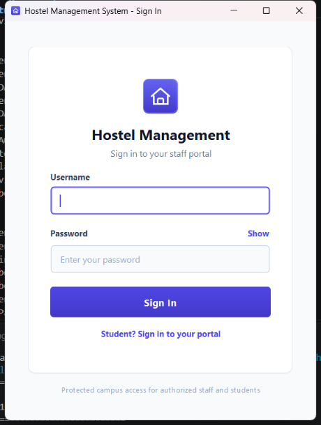

### Student Sign In
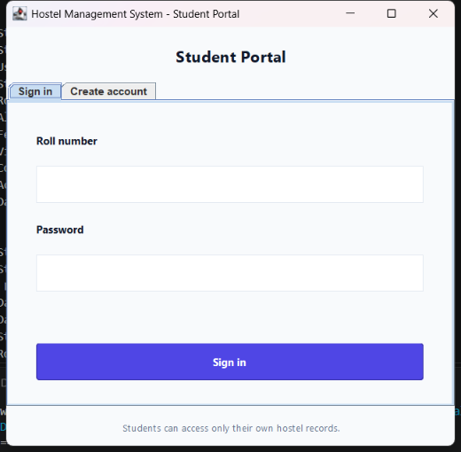

### Student Portal
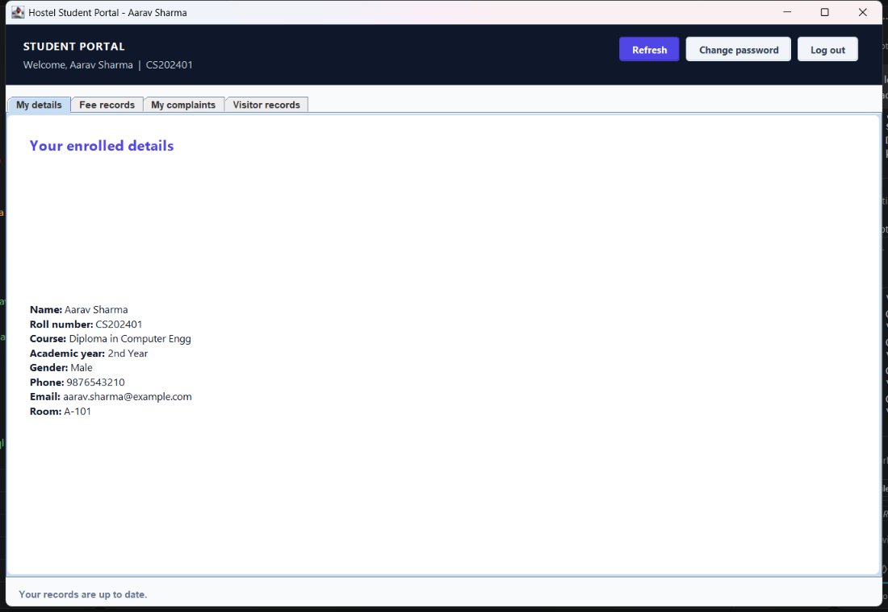

### Dashboard
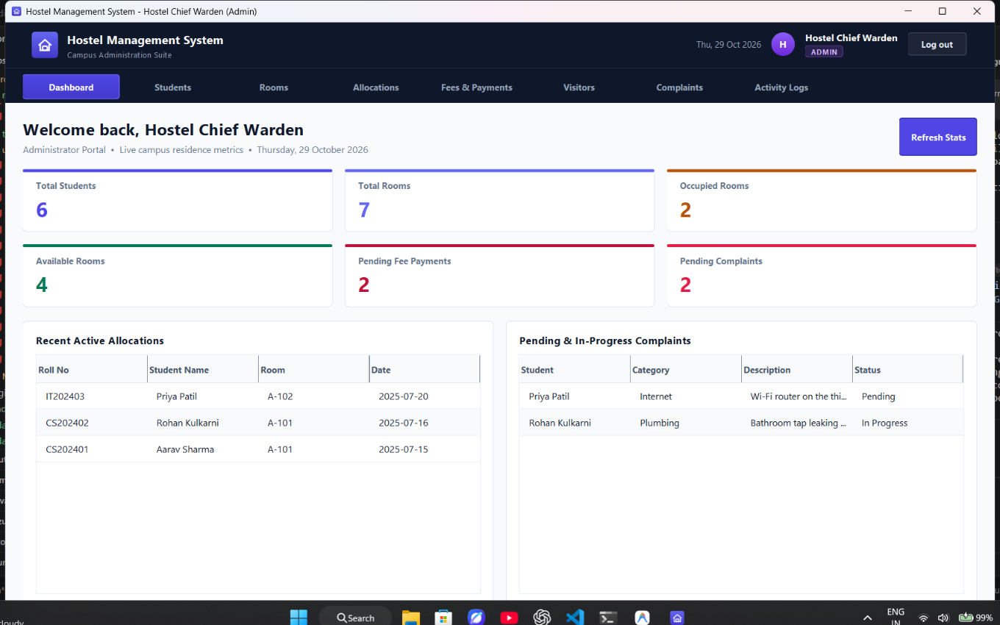

### Student Management
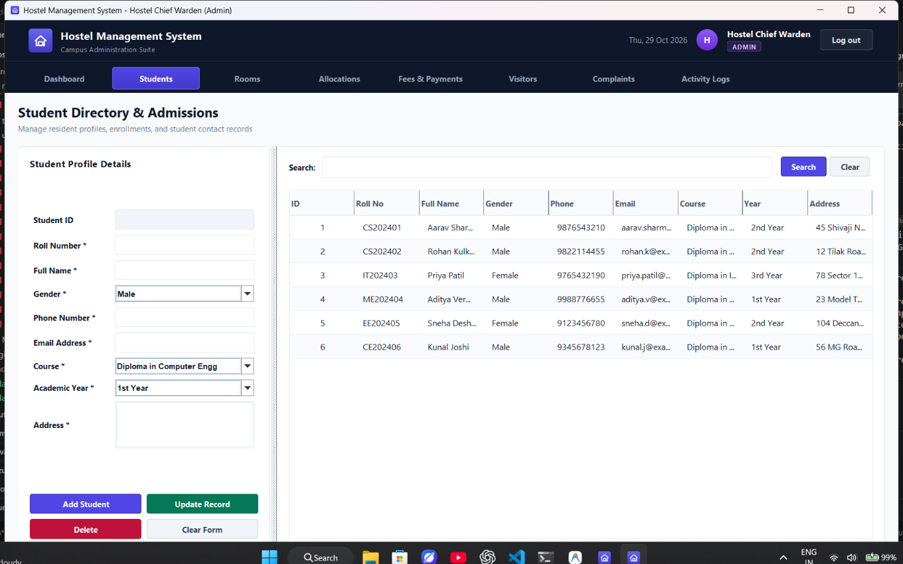

### Room Management
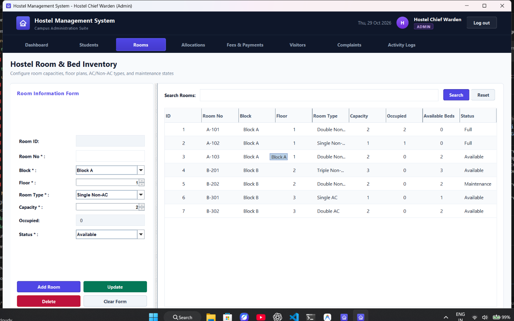

### Room Allocation
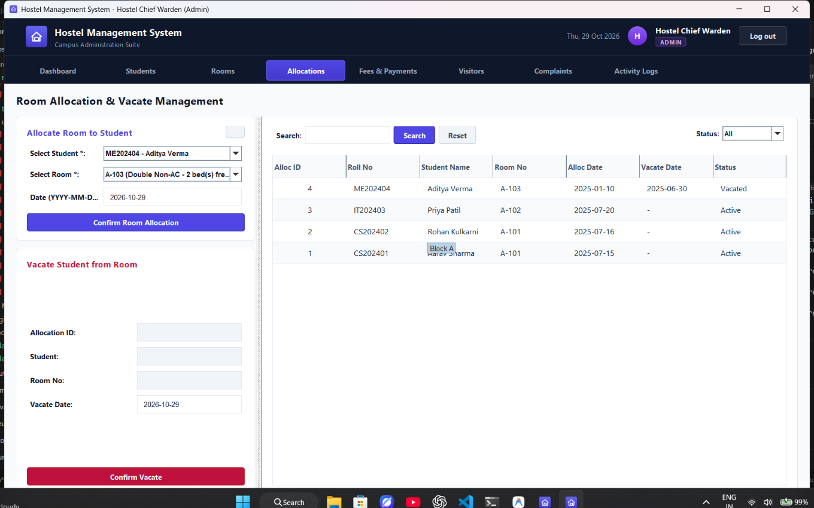

### Fee Management
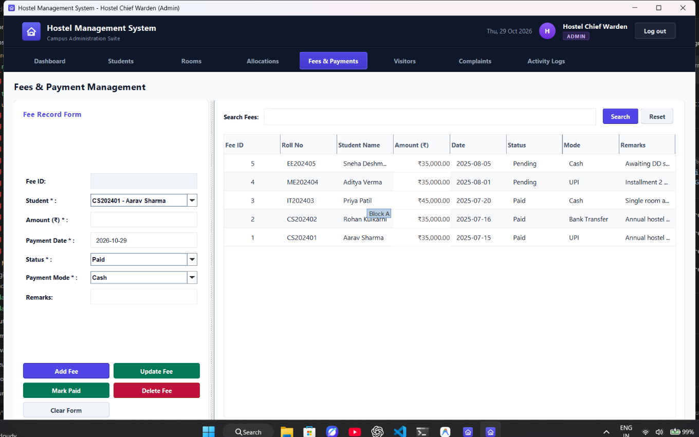

### Visitor Management
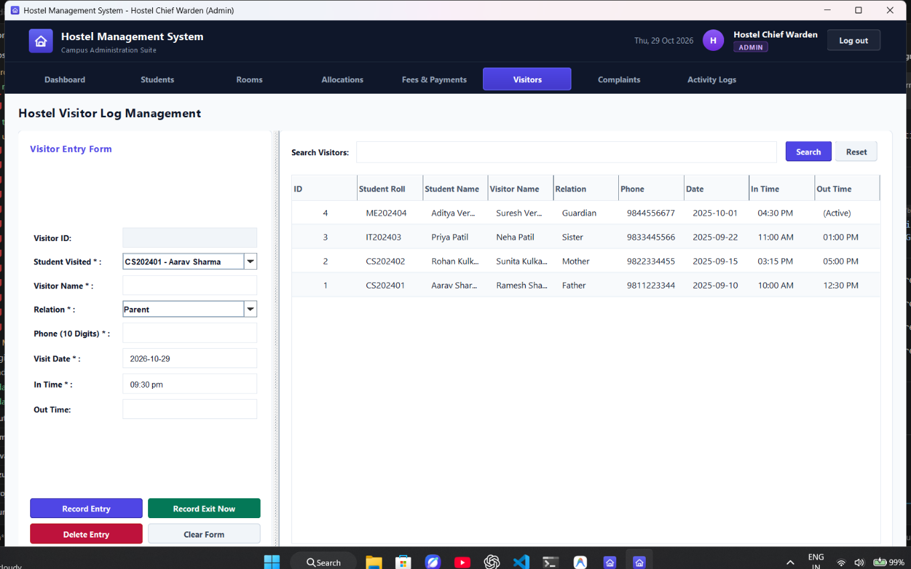

### Complaint Management
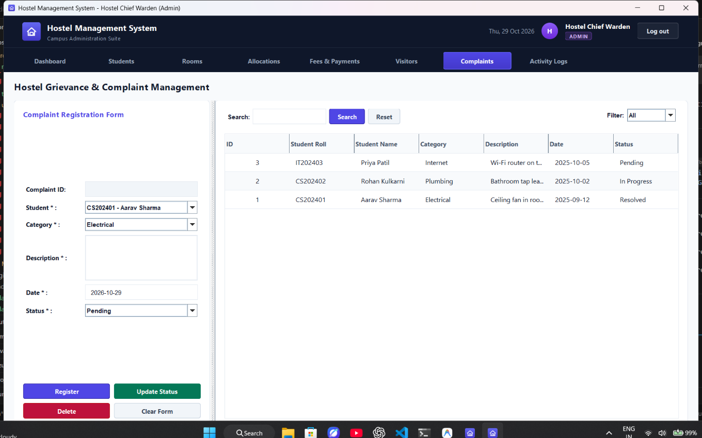

### Activity Logs
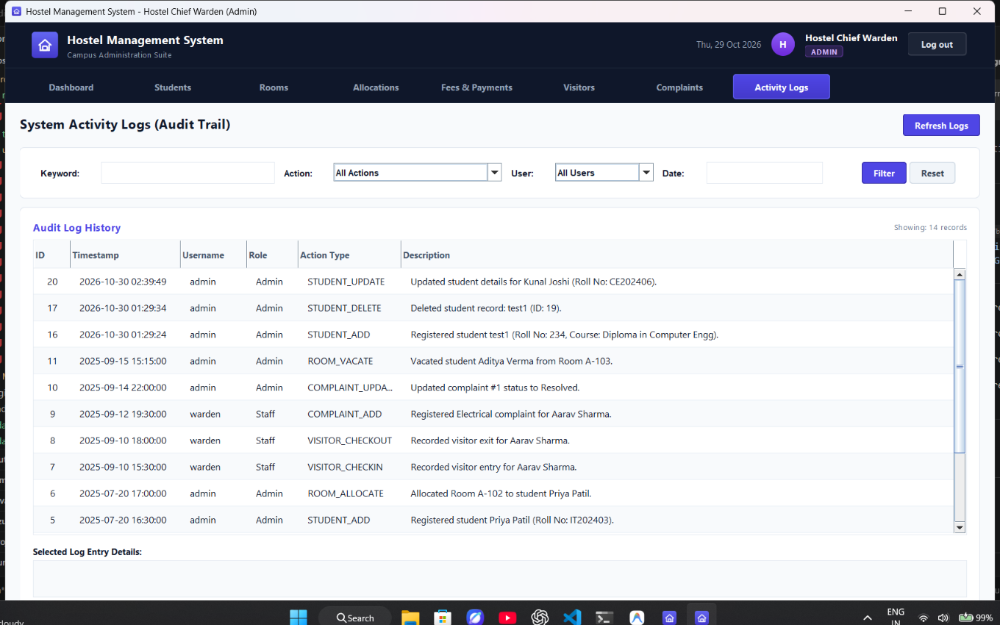

## Project Goals

This project was developed to demonstrate practical implementation of:

* Java programming
* Object-oriented programming
* AWT and Swing
* Event handling
* JDBC
* MySQL
* SQL queries
* CRUD operations
* Exception handling
* Database relationships
* Layered application design

## Future Scope

Possible improvements include:

* More granular role-based permissions
* Password reset and account recovery
* Online fee payment
* Email/SMS notifications
* Student self-service portal
* QR-based visitor management
* Automated report generation
* Database backup and restore
* Cloud-hosted database
* Web and mobile versions
* Advanced analytics and reporting

## Version

Current release:

**v1.0.0**

This is the first stable release of the Hostel Management System.

## License

This project is licensed under the **MIT License**.

See the [`LICENSE`](LICENSE) file for details.

## Author

**Ashwin** ([GitHub](https://github.com/ToxicShadow-YT))

---

If you find this project useful for learning Java, Swing, JDBC, or MySQL, feel free to explore the source code and adapt it for educational purposes.
